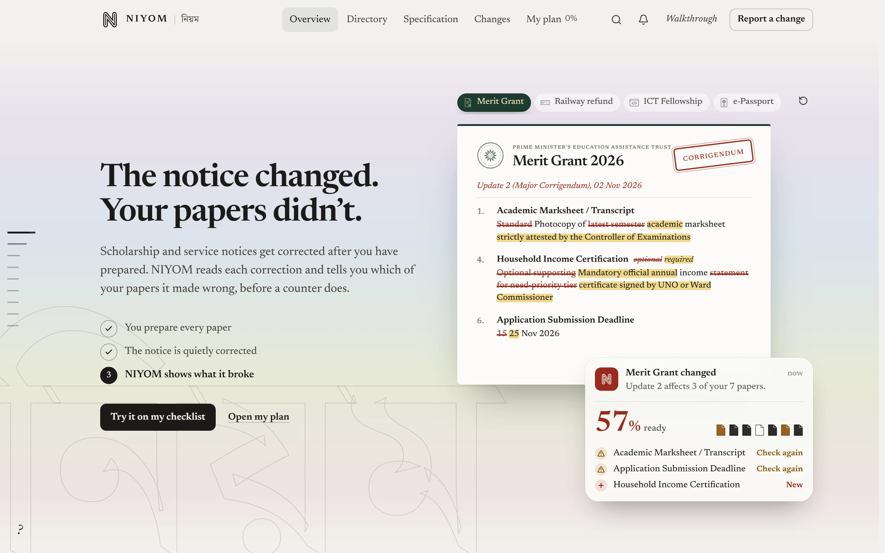
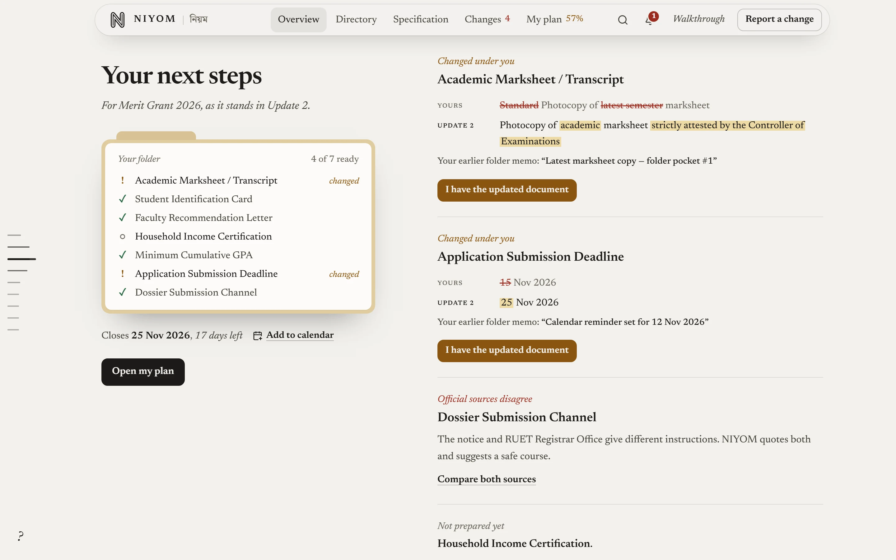
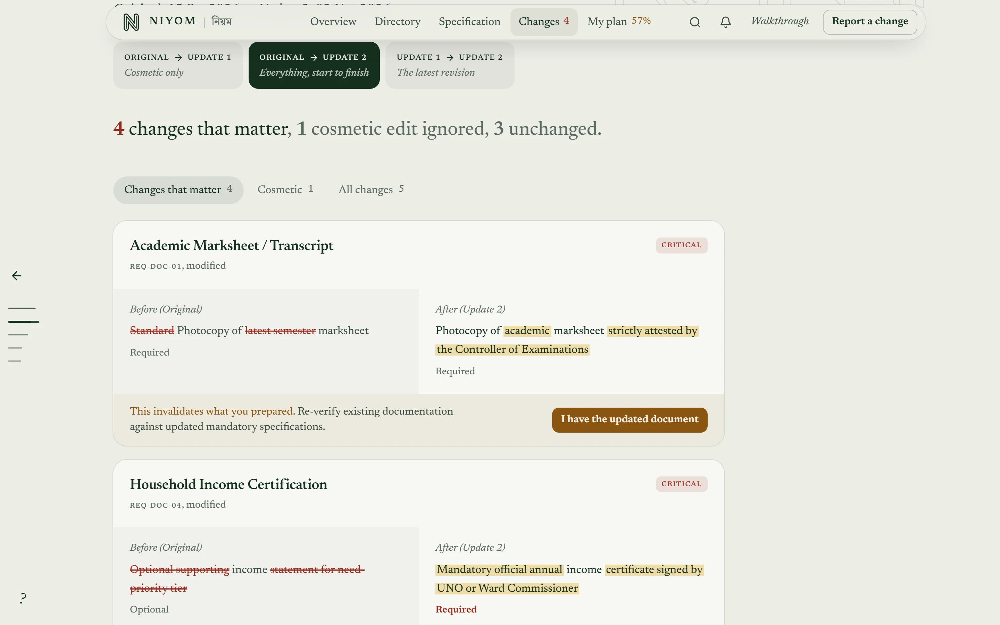
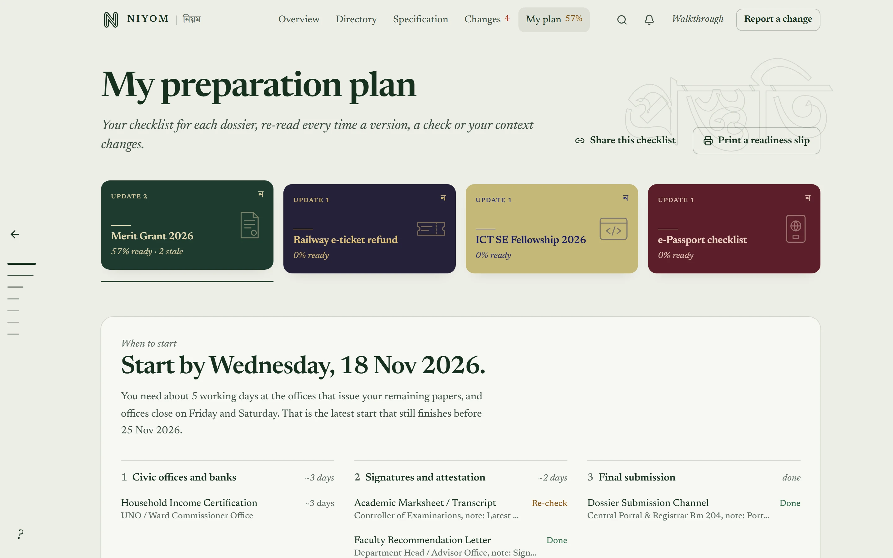
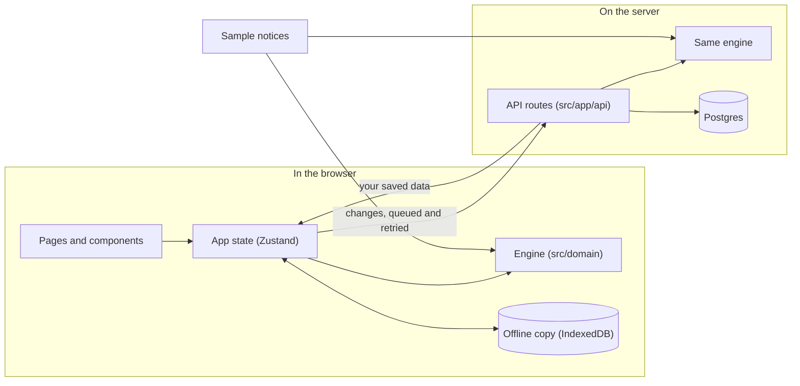

<div align="center">

# NIYOM (নিয়ম)

**Know when a corrected notice makes your papers wrong.**

<a href="https://niyom-swart.vercel.app"><b>Open the live app</b></a>
&nbsp;·&nbsp;
<a href="https://drive.google.com/file/d/1LY6JXQFwtJe2XrxGeg6GAcfFSSYvWwws/view?usp=sharing"><b>Watch walkthrough video</b></a>
&nbsp;·&nbsp;
<a href="https://niyom-swart.vercel.app/api/health">Server and database status</a>
&nbsp;·&nbsp;
<a href="DESIGN_DECISIONS.md">Design decisions</a>
&nbsp;·&nbsp;
<a href="NIYOM_EXECUTION_LOG.md">Build log</a>

<sub>Built for the Credosis Internship Program, Phase 02 (Frontend track)</sub>

</div>

<br>



> [!NOTE]
> **For reviewers: no login, no password, no sign-up.** Open the [live app](https://niyom-swart.vercel.app) or watch the [walkthrough video](https://drive.google.com/file/d/1LY6JXQFwtJe2XrxGeg6GAcfFSSYvWwws/view?usp=sharing). Your browser gets a private, anonymous ID, so two reviewers testing at the same time never see each other's work. To start over, open **Walkthrough** (top right) and choose **Reset the demo**. It works in any modern browser, on desktop and on phones from 360px wide.
>
> The four notices in the app are sample data, modelled on real Bangladeshi notices. They are not official.

**Contents:** [The problem](#the-problem) · [What NIYOM does](#what-niyom-does) · [Key features](#key-features) · [How it works](#how-it-works) · [Try it](#try-it-in-three-minutes) · [Challenges](#challenges-and-how-i-handled-them) · [Potential and scope](#potential-and-scope) · [Run it](#run-it-on-your-computer)

## The problem

In Bangladesh, scholarships, fellowships and public services are announced through official notices. These notices are often corrected after they come out: a deadline moves, a document now needs a different signature, a new paper becomes required.

By then, most students have already prepared their folder. The correction arrives as another PDF on a notice board or a Facebook page, and it looks the same whether it moves a helpdesk to another room or changes what you must submit. Nobody tells the student which of their papers is now wrong. They find out at the counter, when their application is turned away, often too close to the deadline to fix it.

## What NIYOM does

NIYOM keeps every version of a notice and compares them word by word. It tells you which of the papers you already prepared a correction has made wrong, and what to do next. Small edits that don't affect you are recognised and kept off your checklist.

Everything in the app serves one loop:

**Follow a notice → get alerted when it is corrected → see what changed → check the paper again → be ready, on time.**

The home page tells this story in about four seconds, before you read a word. A student has every paper ready (100%). A *Corrigendum* stamp lands on the notice and the changed rules are rewritten. NIYOM's card drops to **57%** and names the two papers to check again and the one that is now required.

## Key features

The brief asked for one core feature and two or three supporting features, with quality over quantity.

### Core feature: a checklist that knows which version you prepared for

Each tick remembers the exact wording of the notice you checked it against. When a correction changes that wording, the tick turns amber (*check again*), your readiness drops, the bell alerts you, and **Your next steps** shows what you prepared next to what the notice now says. One click on **I have the updated document** puts it right, and readiness climbs back.

**The problem it solves:** a student no longer has to re-read every corrected notice and compare it with their folder by hand. NIYOM points to the exact paper that is now wrong.



### Supporting feature 1: word-by-word comparison, with a noise filter

**Changes** shows exactly what changed between two versions: struck words, new words, and how many days a deadline moved. Edits that don't change what you submit, such as a new email address or a moved helpdesk, are marked *cosmetic* and never touch your checklist.

**The problem it solves:** if every edit raised an alarm, students would quickly stop trusting the alerts. The filter keeps alerts for the changes that matter.



### Supporting feature 2: "Does this rule apply to me?"

Each rule is checked against your profile, and NIYOM shows the comparison it made, for example "CGPA 3.78 ≥ 3.25". If a profile field is missing, NIYOM asks for it instead of guessing that you are not eligible.

**The problem it solves:** students see which rules really apply to them, and are never wrongly told they don't qualify.

### Supporting feature 3: When to start

Every paper has an issuing office and a typical lead time in working days. NIYOM counts backwards from the deadline over the Sunday–Thursday working week (offices close Friday and Saturday) and gives the latest safe date to start, with the visits in order.

**The problem it solves:** knowing what you need is not enough if the office needs three working days to issue it. This turns a checklist into a plan.



### Also included

| Feature | What it does |
| --- | --- |
| Alerts | A bell for corrections to the notices you follow, and a phone-style notification when one arrives |
| Deadlines | Days left on every notice, and **Add to calendar**: a calendar file with a reminder three days before |
| Conflicting sources | When two official documents disagree, both are quoted, with a safe course of action |
| Field reports | What students saw at the counter, kept apart from the official rules and counted only after three different people confirm it |
| Notes and a printable slip | A note on each paper (a receipt or serial number), printed on a one-page readiness slip |
| Share link | Opens the same notice and version for someone else, and carries nothing personal |
| Works offline | Your data is kept in the browser and synced with the server when you are back online |
| Live API viewer | The server's real JSON for the notice on screen (footer → **Live API**) |

## How it works

All the logic lives in one small engine written in plain TypeScript ([`src/domain/`](src/domain/)), with no AI and no guessing. The same engine runs in your browser (instant, and it works offline) and on the server (the source of truth). Every number on screen comes from it, and tests pin the figures. A student fully prepared for the original notice ends up at:

| Notice | After the latest correction |
| --- | --- |
| Merit Grant 2026 | **57%** (4 of 7: two papers changed, and the income certificate became required) |
| Railway e-ticket refund | **80%** (4 of 5: a new SMS code step) |
| ICT SE Fellowship 2026 | **60%** (3 of 5: the deadline moved, and a GitHub profile became required) |
| e-Passport checklist | **50%** (2 of 4: the ID wording changed, and an enrolment certificate became required) |

| Feature | How it works | Code |
| --- | --- | --- |
| Version-aware checklist | A tick saves the version and wording it was checked against. When a newer version changes that wording, the tick moves to *check again*. Readiness is *papers that still hold ÷ papers required*. | [`calculate.ts`](src/domain/readiness/calculate.ts) |
| Comparison and noise filter | Each requirement has a stable ID. NIYOM lines up two versions by ID, normalises the text (spacing, punctuation, case) and compares it word by word. Requirements marked as contact details, such as an email or a room number, only ever produce *cosmetic* changes. | [`compare.ts`](src/domain/comparison/compare.ts) |
| "Does this apply to me?" | Each rule names a profile field, a comparison and a value. A missing field gives *needs your profile*, never *not eligible*. | [`applicability.ts`](src/domain/readiness/applicability.ts) |
| When to start | Offices and their lead times in working days, counted backwards from the deadline over the Sunday–Thursday week. | [`intelligence.ts`](src/domain/readiness/intelligence.ts) |
| Saving without accounts | Each browser gets an anonymous ID in an `HttpOnly` cookie. Changes are kept in IndexedDB, queued, and sent to the server, which merges them record by record, so an older change never overwrites a newer one. | [`records.ts`](src/lib/records.ts), [`_lib.ts`](src/app/api/_lib.ts) |
| Field reports | A report becomes a *confirmed pattern* when three different devices confirm it. You can't confirm your own report or confirm one twice, and nobody is told who filed or confirmed it. | [`reports/route.ts`](src/app/api/reports/route.ts) |

How the pieces connect:



The engine knows nothing about the screen or the database. That is why the same code runs in the browser and on the server, and why it is easy to test. Components read results from hooks and never calculate readiness themselves.

## Try it in three minutes

> 📹 **Walkthrough video:** [**Watch the 4-minute demonstration on Google Drive**](https://drive.google.com/file/d/1LY6JXQFwtJe2XrxGeg6GAcfFSSYvWwws/view?usp=sharing)

1. **Watch the opening scene** on the [home page](https://niyom-swart.vercel.app). It plays by itself. Click any of the three steps to replay that moment, or pick another notice above the sheet.
2. **Click "Try it on my checklist".** The same correction is applied to *your* checklist. A notification arrives, the bell shows an alert, and the page scrolls to **Your next steps**. Click **I have the updated document** and watch readiness climb back.
3. **Keep scrolling.** *The corrigendum, word by word* replays the correction like an old film. Then each notice opens like a bundle of papers.
4. **Open My plan.** Set household income to *I don't know*: the income certificate moves to *Needs your profile*. Read *When to start*, add a note to a paper and print the readiness slip.
5. **Open Changes.** Compare any two versions, with cosmetic edits filtered out.
6. **Try the railway case** from the **Walkthrough** menu. Two official sources give different refund timelines, with field reports beside them. Click **Report a change** to file your own.
7. **Open Live API** in the footer to see the server's real JSON for the notice on screen.

## Challenges and how I handled them

**1. Deciding what counts as a change.** Notices get re-issued for small reasons, and if every edit raised an alarm, students would stop trusting the alerts. So each requirement has a stable ID, the text is normalised before it is compared, and contact details are treated as cosmetic. Tests cover both sides: a helpdesk moving rooms changes nothing, while a transcript that must now be attested by the Controller of Examinations turns amber.

**2. Keeping the numbers honest.** An early version had a "Check all required" button: one tap claimed every paper was ready, which made the readiness figure meaningless, so I removed it. The example figures in the brief didn't match the data, so instead of copying them, every figure now comes from the engine and is pinned by tests.

**3. Saving data without accounts, even offline.** A sign-up form would get in the way of students and reviewers alike. Instead, each browser gets an anonymous ID, changes wait in a queue while offline, and the server merges them by time. The same rules run on an embedded Postgres on a laptop and on Neon in production, and tests cover both.

**4. Going live on a serverless host.** On Vercel, each server instance has its own memory, so without a database, saved data seemed to vanish between requests. I connected a managed Postgres database (Neon, in Singapore, the closest region to Bangladesh) and added `/api/health`, which reports the database in use and warns if data would not survive a restart.

**5. Rich visuals without a slow page.** An early 3D background with looping videos added about 1 MB on phones and kept the processor busy, so I removed it. Later, measuring the scroll showed two effects restyling hundreds of elements on every frame. Fixing them took a typical frame from 33 ms to 16.7 ms, which is 60 frames per second.

**6. Explaining the idea in seconds.** My first home page put a notice's clauses next to a version switch. It worked, but at first sight it looked like a form. I replaced it with the four-second scene, which tells the whole story before the visitor reads a word.

## Potential and scope

### Who it can help

- **Students** applying for scholarships, stipends, fellowships and university admissions, where notices are corrected often and deadlines are tight.
- **Job seekers.** Government job circulars and recruitment exams are corrected in the same way: eligibility, fees, documents and dates.
- **Anyone using a public service** with a checklist that changes, such as passports, national ID or a railway refund.
- **Offices that publish notices.** A university scholarship office or an NGO could publish its notices as structured requirements. Every applicant would then be alerted the moment a rule changes, and fewer people would be turned away at the counter.

### Why it can grow

- **The engine is not tied to these four notices.** Comparison, readiness and planning work on any notice written as a list of requirements with stable IDs. The sample notices are data ([`notices.seed.ts`](src/data/seed/notices.seed.ts)); offices, lead times and colours are small lookup tables.
- **Every result can be explained.** Each figure traces back to a rule and a version, with no AI guesswork. That matters when the answer decides whether someone's application is accepted.
- **Built for the people who need it.** It works on phones from 360px wide and keeps working offline, which matters for students on mobile data.

### What it does not do yet

- The notices, offices and lead times are hand-made sample data.
- There are no accounts, so your data stays with your browser and does not follow you to another device.
- Alerts appear only inside the app.
- Rate limits are counted per server instance.

### What I would build next, in order

1. **Bring in real notices.** Turn a notice PDF into structured requirements automatically, with a person reviewing each one before it is published.
2. **Alerts outside the app.** SMS or email when a notice you follow is corrected, since students don't keep the app open.
3. **A Bangla interface.** Most of the students this is for would rather read it in Bangla.
4. **Optional accounts.** Your checklist on any device, without making sign-up mandatory.
5. **Exact rate limits.** A shared store such as Redis, so limits hold across all server instances.

## Built with

| Part | What is used |
| --- | --- |
| Framework | Next.js 16 (App Router), React 19 |
| Language | TypeScript, strict mode |
| Styling | Tailwind CSS v4, CSS animations (including scroll-driven ones) |
| State in the browser | Zustand, with an offline copy in IndexedDB (Dexie) |
| Validation | Zod, shared by the browser and the server |
| Server | Next.js Route Handlers (the `/api` routes) |
| Database | PostgreSQL: Neon on the live site, an embedded Postgres (PGlite) on your computer |
| Tests | Vitest: 81 tests covering the engine, the figures on the home page, the word diff, the whole API (in memory and on real Postgres) and syncing |
| Hosting | Vercel |

## Run it on your computer

You need **Node.js 20.9 or later**.

```bash
git clone https://github.com/argh-finds404/niyom.git
cd niyom
npm install
npm run dev        # open http://localhost:3000
```

No setup or environment variables are needed. Without a database address, the server starts a small Postgres database inside the project folder (`.data/pglite`), so everything works the same as on the live site. Optional settings are listed in [`.env.example`](.env.example).

```bash
npm test           # run the tests
npm run lint       # check code style
npm run typecheck  # check types
npm run build      # production build
```

<details>
<summary><b>How the code is organised</b></summary>

```
src/
  domain/         The engine: comparing versions, readiness, "does this apply to me?", when to start.
                  Plain TypeScript, with no React, Next.js or database code.
  data/
    seed/         The four sample notices and the sample student profile
    persistence/  Saving data: IndexedDB in the browser, Postgres or a file on the server
  hooks/          App state (Zustand), syncing with the server, and the walkthrough steps
  lib/            Small helpers: alerts, deadlines, calendar files, word diff, formatting
  app/            Pages, and the API in app/api
  components/
    layout/       Top bar, side rail, footer, alerts, search and panels
    ledger/       Requirement rows, the details panel, the word-by-word redline
    screens/      One component per page
    ui/           The opening scene, the notice objects, the film scene, buttons and other basics
tests/            Tests for the engine, the word diff, the features and the whole API
```

</details>

<details>
<summary><b>API reference</b></summary>

Every route uses the same engine as the app, and all input is checked with Zod before anything is saved.

| Method | Path | What it does |
| --- | --- | --- |
| GET | `/api` | Lists every route |
| GET | `/api/health` | Is the server up, which database it uses, and whether data survives a restart |
| GET | `/api/dossiers` | All notices, with the version you follow and report counts |
| GET, PATCH | `/api/dossiers/:id` | One notice in full / change the version your checklist follows |
| GET | `/api/compare?notice=…&from=1&to=3` | The word-by-word comparison between two versions |
| POST | `/api/evaluate` | Your readiness for a notice, paper by paper, with offices and lead times |
| GET | `/api/plan?notice=…` | When to start, and the visits in order |
| GET, PUT, DELETE | `/api/state` | Read, save or reset your own data |
| GET, POST, PATCH | `/api/reports` | Read field reports, file one, or confirm one |
| GET | `/api/calendar/:id` | The deadline as a calendar file |

- **Privacy:** your profile, ticks and notes are visible only to your browser's anonymous ID. Field reports are public, but who filed or confirmed them is never shown.
- **Errors:** every error is JSON with a clear status (`400` bad input, `404` not found, `413` too large, `422` unknown notice or version, `429` too many requests, `503` database unavailable) and a request ID that matches the server log.
- **Limits:** filing reports, confirming reports and saving data are rate-limited per device and per IP address.
- **Storage:** with `DATABASE_URL` set (the live site), data goes to that Postgres database, and tables are created on first use. Without it, an embedded Postgres in `.data/pglite` is used, with a JSON file as the last fallback.

</details>

---

<sub>The notices, office names and lead times are sample data prepared for the Credosis Phase 02 demonstration. NIYOM is not connected to any institution named in it. Always confirm with the issuing office.</sub>
