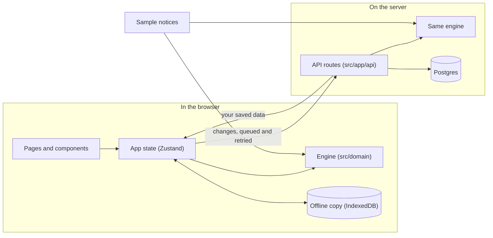

# NIYOM (নিয়ম)

**Know when a corrected notice makes your papers wrong.**

In Bangladesh, scholarships, fellowships and public services are announced through official notices. These notices are often corrected after they come out: a deadline moves, a document now needs a different signature, a new paper becomes required. By then, most students have already prepared their folder, and nobody tells them what changed. They find out at the counter, when their application is turned away.

NIYOM keeps every version of a notice and compares them word by word. It tells you which of the papers you already prepared a correction has made wrong, and what to do next. Small edits that don't affect you, like a helpdesk moving to another room, are recognised and kept off your checklist.

| | |
| --- | --- |
| **Live app** | [niyom-swart.vercel.app](https://niyom-swart.vercel.app) |
| **Server and database status** | [niyom-swart.vercel.app/api/health](https://niyom-swart.vercel.app/api/health) |
| **Source code** | [github.com/argh-finds404/niyom](https://github.com/argh-finds404/niyom) |
| **Built for** | Credosis Internship Program, Phase 02 (Frontend track) |

> The four notices in the app are sample data, modelled on real Bangladeshi notices. They are not official.

---

## For the evaluation team

### 📝 What I built

A web app that follows official notices version by version, for the student who has to act on them. It answers one question: *"After this correction, are my papers still right?"*

- It works on four sample notices: a university merit grant, a railway e-ticket refund, an ICT software fellowship and an e-passport checklist.
- Each notice has two or three published versions, so you can watch a correction arrive and see what it does to a student's folder.
- It has a real backend: an API, a Postgres database, private storage for each visitor, and public field reports that need three confirmations before they count.

### 🔑 Login and access

**No login, no password, no sign-up.** Open [niyom-swart.vercel.app](https://niyom-swart.vercel.app) and start.

- On your first visit, the server gives your browser a private, anonymous ID (stored in an `HttpOnly` cookie). Your profile, ticks and notes are saved under that ID in the database. Two reviewers testing at the same time never see each other's work.
- To start fresh, open **Walkthrough** (top right) and choose **Reset the demo**, or use a private browser window.
- It works in any modern browser, on desktop and on phones from 360px wide.

### ⚙️ What is implemented

The brief asked for one core feature and two or three supporting features, with quality over quantity. Here is how NIYOM maps to it.

**Core feature: a checklist that knows which version you prepared for.**
Each tick remembers the exact wording of the notice you checked it against. When a correction changes that wording, the tick turns amber (*check again*), your readiness drops, the bell alerts you, and *Your next steps* shows what you prepared next to what the notice now says. One click on **I have the updated document** puts it right. The home page opens with a four-second scene that plays this whole story.

**Supporting features: the three that make the idea understandable.**

| | Feature | Why it matters to the student |
| --- | --- | --- |
| 1 | **Word-by-word comparison, with a noise filter** | Shows exactly what changed between two versions: struck words, new words, and how many days a deadline moved. Edits that don't change what you submit (a new email address, a moved helpdesk) are marked *cosmetic* and never touch your checklist. |
| 2 | **"Does this rule apply to me?"** | Each rule is checked against your profile (for example, "CGPA 3.78 ≥ 3.25"). If a profile field is missing, NIYOM asks for it instead of guessing that you are not eligible. |
| 3 | **When to start** | Adds up the working days each office needs (offices close Friday and Saturday) and gives the latest safe date to start, with the visits in order. |

**Also included, to make the demo feel complete:**
- **Alerts:** a bell for corrections to the notices you follow.
- **Deadlines:** days left, and an **Add to calendar** file with a reminder.
- **Conflicting sources:** when two official documents disagree, both are shown, with a safe course of action.
- **Field reports:** what students saw at the counter, confirmed only by three different people.
- **Notes on papers, and a printable readiness slip.**
- **A share link** that carries nothing personal.
- **Offline mode.**
- **A Live API viewer.**

### ✅ The Phase 02 brief, point by point

| The brief asks for | Where to find it |
| --- | --- |
| At least one core feature | The version-aware checklist: the home page scene, **Try it on my checklist**, then *Your next steps* and **My plan** |
| Two or three supporting features | **Changes** (comparison and noise filter), **My plan** (your profile and "does it apply"), *When to start* |
| A working demonstration | The [live app](https://niyom-swart.vercel.app), with a real API and database, and the walkthrough video |
| The problem, the features, the challenges | This README: the introduction, [Try it in three minutes](#try-it-in-three-minutes) and [Challenges](#challenges-and-how-i-handled-them) |
| Understanding the code | [How the key features work](#-how-the-key-features-work), [How the code is organised](#how-the-code-is-organised) and [`DESIGN_DECISIONS.md`](DESIGN_DECISIONS.md) |

### 💡 How the key features work

**1. Checking your papers against the current version.**
When you tick a paper, NIYOM saves which version of the notice you checked it against. When a newer version changes that requirement, the tick is no longer trusted: it moves to *check again* until you confirm you have the updated document. Your readiness is simply *papers that still hold ÷ papers required*. All of this lives in one small engine written in plain TypeScript (`src/domain/`), with no AI and no guessing. The same engine runs in your browser (instant, works offline) and on the server (the source of truth). Every number on screen comes from it, and tests pin them: for example, a student fully prepared for the original Merit Grant is **57%** ready after Update 2.

**2. Telling real changes from cosmetic ones.**
Each requirement has an ID. NIYOM lines up the two versions by ID, normalises the text (spacing, punctuation, case), and compares word by word. A change to a field marked as contact information, such as an email or room number, is labelled *cosmetic*. Anything that changes what you must submit or do counts as a real change.

**3. Knowing when to start.**
Every paper has an issuing office and a typical lead time in working days. NIYOM counts backwards from the deadline over the Sunday–Thursday working week and gives you the latest safe start date, with the visits in order.

**4. Field reports you can trust.**
Anyone can report what happened at a counter. A report only becomes a *confirmed pattern* when three different devices confirm it. You can't confirm your own report or confirm the same report twice, and the server never reveals who filed or confirmed it.

**5. Saving without accounts.**
Your browser keeps a copy of your data (IndexedDB), so the app is instant and works offline. Each change is queued and sent to the server, which merges it record by record, so an older change can never overwrite a newer one. On the live site the server stores everything in a Postgres database (Neon, Singapore region).

---

## Try it in three minutes

You can follow these steps on the [live site](https://niyom-swart.vercel.app) or [on your own computer](#run-it-on-your-computer).

1. **Watch the opening scene.** It plays by itself: a student has every paper ready (100%). Then the Merit Grant is corrected: the stamp lands, and the changed rules are struck and rewritten. Then NIYOM's card drops to **57%** and names the two papers to check again and the one that is now required. Click any of the three steps to replay that moment, or pick another notice above the sheet (Railway 80%, ICT 60%, e-Passport 50%).
2. **Click "Try it on my checklist".** The same correction is applied to *your* checklist. A notification arrives, the bell shows an alert, and the page scrolls to **Your next steps**. Each changed paper shows what you prepared next to what the notice now says. Click **I have the updated document** and watch readiness climb back.
3. **Keep scrolling.** *The corrigendum, word by word* replays the correction like an old film. Then each notice opens like a bundle of papers.
4. **Open My plan.** Set household income to *I don't know*: the income certificate moves to *Needs your profile*. Read *When to start*, add a note to a paper and print the readiness slip.
5. **Open Changes.** See the full word-by-word comparison between any two versions, with cosmetic edits filtered out.
6. **Try the railway case** (from the **Walkthrough** menu). Two official sources give different refund timelines; field reports sit beside them. Click **Report a change** to file your own.
7. **Open Live API** (in the footer). See the server's real JSON for the notice on screen, and whether your data is backed up.

## How I worked

- **One problem, one loop.** Every feature had to serve the same loop: follow a notice → get alerted → see what changed → check the paper again → be ready. Ideas that didn't serve it were left out or removed.
- **Small phases, each one verified.** Every phase ended with the type checker, the linter, the tests, a production build, and a check in the browser at phone and desktop widths. The record is in [`NIYOM_EXECUTION_LOG.md`](NIYOM_EXECUTION_LOG.md).
- **Decisions written down.** Each design choice, and each thing I removed, is explained in [`DESIGN_DECISIONS.md`](DESIGN_DECISIONS.md), so a reviewer can see the reasoning and not just the result.
- **Measure, then change.** Size and speed problems were measured in a production build before anything was changed, and measured again after.

## Challenges and how I handled them

**1. Deciding what counts as a change.**
Notices get re-issued for small reasons. If every edit raised an alarm, students would quickly stop trusting the alerts. So each requirement has a stable ID, the text is normalised before it is compared, and contact details (an email address, a room number) are treated as cosmetic. Tests cover both sides: a helpdesk moving rooms changes nothing, while a transcript that must now be attested by the Controller of Examinations turns amber.

**2. Keeping the numbers honest.**
An early version had a "Check all required" button: one tap claimed every paper was ready, which made the readiness figure meaningless. I removed it. The example figures in the original brief also didn't match the data, so instead of copying them, every figure now comes from one engine and is pinned by tests. A missing profile field is asked for, never treated as "not eligible".

**3. Saving data without accounts, even offline.**
A sign-up form would get in the way of both students and reviewers. Instead, each browser gets an anonymous ID, changes wait in a queue while offline, and the server merges them by time, so an old change never overwrites a new one. The same rules run on an embedded Postgres on a laptop and on Neon in production, and tests cover both.

**4. Going live on a serverless host.**
On Vercel, each server instance has its own memory, so without a database, saved data seemed to vanish between requests. I connected a managed Postgres database (Neon, in Singapore) and added `/api/health`, which reports the database in use and warns if data would not survive a restart.

**5. Rich visuals without a slow page.**
An early 3D background with looping videos looked impressive, but it added about 1 MB on phones and kept the processor busy, so I removed it. Later, measuring the scroll showed two small effects restyling hundreds of elements on every frame. Fixing them took a typical frame from 33 ms to 16.7 ms, which is 60 frames per second.

**6. Explaining the idea in seconds.**
My first home page put a notice's clauses next to a version switch. It worked, but at first sight it looked like a form. I replaced it with a four-second scene that tells the whole story before the visitor reads a word.

## Screens

| Screen | What it's for |
| --- | --- |
| **Overview** | The opening scene, the film-style replay of a correction, your next steps, when to start, and one chapter per notice |
| **Directory** | Every notice, with search, category tabs, filters and a sortable table |
| **Specification** | One notice's requirements, versions, sources and field reports |
| **Changes** | The word-by-word comparison between two versions |
| **My plan** | Your profile, readiness for each notice, the visit plan, notes, the printable slip and a share link |
| **Panels** | Search (Ctrl K), alerts, requirement details, the report form, help and the Live API viewer |

## Run it on your computer

You need **Node.js 20.9 or later**.

```bash
git clone https://github.com/argh-finds404/niyom.git
cd niyom
npm install
npm run dev        # open http://localhost:3000
```

No setup or environment variables are needed. Without a database address, the server starts a small Postgres database inside the project folder (`.data/pglite`), so everything works the same as the live site. Optional settings are listed in [`.env.example`](.env.example).

Other commands:

```bash
npm run build      # production build
npm start          # run the production build
npm test           # run the tests
npm run lint       # check code style
npm run typecheck  # check types
```

## Tech stack

| Part | What is used |
| --- | --- |
| Framework | Next.js 16 (App Router), React 19 |
| Language | TypeScript, strict mode |
| Styling | Tailwind CSS v4, CSS animations (including scroll-driven ones) |
| State in the browser | Zustand, with an offline copy in IndexedDB (Dexie) |
| Validation | Zod, shared by the browser and the server |
| Server | Next.js Route Handlers (the `/api` routes) |
| Database | PostgreSQL: Neon on the live site, an embedded Postgres (PGlite) on your computer |
| Tests | Vitest |
| Hosting | Vercel |

## How the code is organised

```
src/
  domain/         The engine: comparing versions, readiness, "does this apply to me?", when to start.
                  Plain TypeScript, with no React, Next.js or database code.
  data/
    seed/         The four sample notices and the sample student profile
    persistence/  Saving data: IndexedDB in the browser, Postgres or a file on the server
  hooks/          App state (Zustand), syncing with the server, and the walkthrough steps
  lib/            Small helpers: alerts, deadlines, calendar files, word diff, formatting
  app/            Pages, and the API in app/api
  components/
    layout/       Top bar, side rail, footer, alerts, search and panels
    ledger/       Requirement rows, the details panel, the word-by-word redline
    screens/      One component per page
    ui/           The opening scene, the notice objects, the film scene, buttons and other basics
tests/            Tests for the engine, the word diff, the features and the whole API
```

How the pieces talk to each other:



The engine knows nothing about the screen or the database. That's why the same code can run in the browser (instant, and offline) and on the server (the source of truth), and why it is easy to test. Components read results from hooks and never calculate readiness themselves.

The files worth reading first:

| File | What it does |
| --- | --- |
| `src/domain/comparison/compare.ts` | Lines up two versions by requirement ID and labels each change (added, removed, modified; real or cosmetic) |
| `src/domain/readiness/calculate.ts` | Turns your ticks into readiness, marking a tick out of date when the wording you checked has changed |
| `src/domain/readiness/applicability.ts` | Decides whether a rule applies to your profile, and says so when a field is missing |
| `src/domain/readiness/intelligence.ts` | Offices, lead times and the working-day count behind *When to start* |
| `src/lib/records.ts` | Merges changes from the browser and the server, so the newer one always wins |
| `src/data/persistence/server-db.ts` | Chooses where the server stores data: Postgres, embedded Postgres or a file |
| `src/app/api/_lib.ts` | What every API route shares: the anonymous ID cookie, input checks, rate limits and errors |
| `src/components/ui/HeroScene.tsx` | The opening scene on the home page |

## API

Every route uses the same engine as the app. All input is checked with Zod before anything is saved.

| Method | Path | What it does |
| --- | --- | --- |
| GET | `/api` | Lists every route |
| GET | `/api/health` | Is the server up, which database it uses, and whether data survives a restart |
| GET | `/api/dossiers` | All notices, with the version you follow and report counts |
| GET, PATCH | `/api/dossiers/:id` | One notice in full / change the version your checklist follows |
| GET | `/api/compare?notice=…&from=1&to=3` | The word-by-word comparison between two versions |
| POST | `/api/evaluate` | Your readiness for a notice, paper by paper, with offices and lead times |
| GET | `/api/plan?notice=…` | When to start, and the visits in order |
| GET, PUT, DELETE | `/api/state` | Read, save or reset your own data |
| GET, POST, PATCH | `/api/reports` | Read field reports, file one, or confirm one |
| GET | `/api/calendar/:id` | The deadline as a calendar file |

- **Privacy:** your profile, ticks and notes are visible only to your browser's anonymous ID. Field reports are public, but who filed or confirmed them is never shown.
- **Errors:** every error is JSON with a clear status (`400` bad input, `404` not found, `413` too large, `422` unknown notice or version, `429` too many requests, `503` database unavailable) and a request ID that matches the server log.
- **Limits:** filing reports, confirming reports and saving data are rate-limited per device and per IP address.

## Where the data lives

| Situation | Where your data goes |
| --- | --- |
| `DATABASE_URL` is set (the live site) | That Postgres database. Tables are created automatically on first use. `POSTGRES_URL` and `STORAGE_URL` are read too. |
| On your computer, with no database address | A small embedded Postgres in `.data/pglite`, using the same driver and SQL as the live site |
| Fallback | A JSON file in `.data/` (if the embedded database can't start, or `NIYOM_STORE=file`) |

In Postgres, each save is a single statement, and the database enforces the rule: a newer tick always wins, and a person can confirm a report only once. So it stays correct even with many servers at once. `/api/health` always tells you which database is in use and warns if data would not survive a restart.

## Tests and checks

```bash
npm test           # 81 tests in 8 files
npm run lint
npm run typecheck
npm run build
```

The tests cover the comparison and readiness engine, the exact figures shown on the home page for each notice, the word diff, alerts, deadlines and calendar files, the whole API (against an in-memory store and against real Postgres) and syncing between the browser and the server.

Every release was also checked by hand in Chrome, in a production build, at phone, tablet and desktop widths:
- no page scrolls sideways;
- every panel fits;
- the main flows work;
- the console has no errors;
- an idle page does no work in the background;
- scrolling the home page runs at 60 frames per second (a typical frame takes 16.7 ms).

## Deploying your own copy

1. Import the repository into [Vercel](https://vercel.com).
2. In the project's **Storage** tab, add a **Neon Postgres** database and connect it. This sets `DATABASE_URL` for you.
3. Deploy, then open `/api/health`. You should see `"database": "postgres (DATABASE_URL)"` and `"durable": true`.

Without a database, the app still works on Vercel (each browser keeps its own copy), but the server's data lives only in memory and `/api/health` will warn you.

## Known limits and next steps

What the demo does not do yet:
- The notices, offices and lead times are hand-made sample data.
- There are no accounts, so your data stays with your browser and does not follow you to another device.
- Alerts appear only inside the app.
- Rate limits are counted per server instance.

What I would build next, in order:
1. **Bring in real notices.** Turn a notice PDF into structured requirements automatically, with a person reviewing each one before it is published.
2. **Alerts outside the app.** SMS or email when a notice you follow is corrected, since students don't keep the app open.
3. **A Bangla interface.** Most of the students this is for would rather read it in Bangla.
4. **Optional accounts.** Your checklist on any device, without making sign-up mandatory.
5. **Exact rate limits.** A shared store such as Redis, so limits hold across all server instances.

## More documents

| Document | What's inside |
| --- | --- |
| [`DESIGN_DECISIONS.md`](DESIGN_DECISIONS.md) | Why the app looks and behaves the way it does |
| [`NIYOM_EXECUTION_LOG.md`](NIYOM_EXECUTION_LOG.md) | How it was built and tested, step by step |

---

*The notices, office names and lead times are sample data prepared for the Credosis Phase 02 demonstration. NIYOM is not connected to any institution named in it. Always confirm with the issuing office.*
